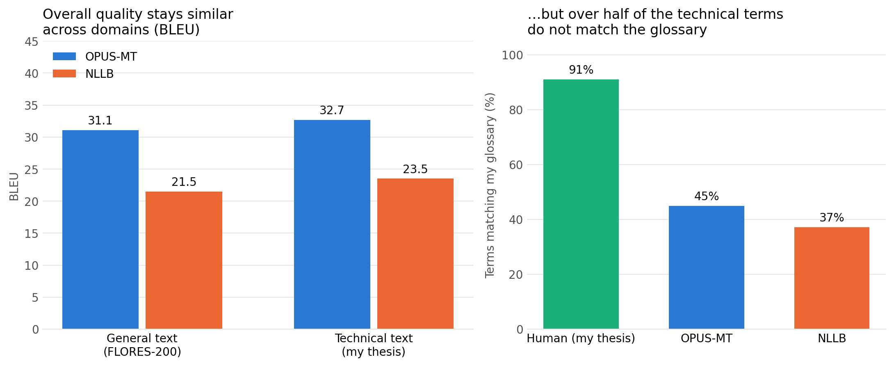

# Lost in Terminology: What BLEU Misses in English→Turkish Technical Translation

## Motivation

As a translation student, I used machine translation tools and language models quite often during my studies. Sometimes they made horrible mistakes; at other times they were better translators than me. They were faster and used the language more fluently, but this was mostly the case with general texts. They did not show the same performance with technical texts. What makes technical texts different, and harder to translate, is terminology. Terminology is the heart of a technical text: it is the part professionals look for. So I wanted to see whether these models would use the right terminology and stay consistent throughout a text.

I also wanted to see whether the standard metrics would notice. BLEU counts how many words and word sequences a translation shares with a reference translation; chrF does the same with characters. Neither can understand what the words mean: for them, words are just symbols. So they cannot tell whether a term refers to the right concept. A correct synonym is penalised just for being different from the reference, while a wrong term can still score well if the rest of the sentence matches. A translator looks at the meaning instead: does the term refer to the right concept, and is it the established equivalent in the field? A different word can be correct (*göz takipçisi* for *eye tracker*), and a familiar-looking word can be wrong (*çeviri hazırlama* for *drafting*, which loses the specific stage of writing a draft). This is where a human translator plays an important role.

## Research question

Do automatic metrics (BLEU, chrF) capture how well open-source MT systems handle domain terminology when translating English technical text into Turkish?

## Data

| Set | Source | Domain | Size | Reference |
|---|---|---|---|---|
| FLORES-200 | `devtest`, first 200 sentences | General (Wikinews, Wikivoyage, Wikijunior) | 200 sentence pairs | Professional translators (Meta) |
| Thesis | Green, Heer & Manning (2013), *The Efficacy of Human Post-Editing for Language Translation*, CHI '13 — Abstract, Introduction, Related Work | Technical / academic (NLP, HCI) | 76 sentence pairs | My own translation (BA thesis, Istanbul University) |

**Note on the thesis data:** The source paper is copyrighted by ACM and my translation is a derivative work, so the full parallel text is not included in this repository. The code runs on any sentence-aligned EN–TR file with `en` and `tr` columns.

**Sentence alignment:** 74 of 76 pairs align one-to-one. In two places my translation split or merged sentences; these were aligned by hand (one EN sentence ↔ two TR sentences, and two EN sentences ↔ one TR sentence).

**Glossary:** 19 terms from the 44-term EN–TR glossary I built for the thesis occur in the selected text (78 occurrences in total).

## Models

| Model | Hugging Face ID | Notes |
|---|---|---|
| OPUS-MT | `Helsinki-NLP/opus-mt-tc-big-en-tr` | Bilingual model, trained only for EN→TR |
| NLLB-200 | `facebook/nllb-200-distilled-600M` | Multilingual (200 languages), distilled 600M version |

Both models were run with default decoding settings in Google Colab (T4 GPU).

## Method

1. **Automatic metrics:** corpus-level BLEU and chrF with `sacrebleu`, against the human reference.
2. **Terminology accuracy:** for each glossary term found in an English sentence, check whether an accepted Turkish equivalent appears in the translation. Matching uses word stems to handle Turkish suffixes (e.g. *kaynak met-* matches *kaynak metin* and *kaynak metnin*), and a Turkish-aware lowercasing step (I/ı, İ/i).
3. **Manual review:** every case where the automatic check found no match (92 cases) was reviewed and labelled:
   - **D** – different but correct equivalent
   - **E** – term left in English, or only given a Turkish suffix (e.g. *post-editleme*)
   - **Y** – wrong translation
   - **A** – term omitted

   I counted a translation as correct when it kept the meaning of the term, even if it used a different word from my glossary (for example *göz takipçisi* instead of *göz izleyici* for *eye tracker*). If a word looked familiar but shifted the meaning, I counted it as wrong (for example *çeviri hazırlama* for *drafting*, which loses the idea of a draft). To check how consistent my judgements were, I compared them with a second set of labels produced independently with an AI assistant: the two sets agreed on 86% of the 92 cases (Cohen's κ ≈ 0.76). I went through every disagreement and made the final decision myself.

## Results

### Automatic metrics

| Data | Model | BLEU | chrF |
|---|---|---|---|
| FLORES-200 (general) | OPUS-MT | 31.1 | 62.0 |
| FLORES-200 (general) | NLLB-200 | 21.5 | 55.3 |
| Thesis (technical) | OPUS-MT | 32.7 | 60.0 |
| Thesis (technical) | NLLB-200 | 23.5 | 53.5 |

### Terminology (78 term occurrences)

| Translation | Matches glossary | + correct alternatives | Left in English | Wrong / omitted |
|---|---|---|---|---|
| Human (my thesis) | 71 (91%) | – | – | – |
| OPUS-MT | 35 (45%) | 48 (62%) | 26 (33%) | 4 (5%) |
| NLLB-200 | 29 (37%) | 38 (49%) | 28 (36%) | 12 (15%) |

## Findings

**1. OPUS-MT outperformed NLLB-200 on both texts.** OPUS-MT scored about 10 BLEU points higher on both the general and the technical text. This was expected: OPUS-MT is trained only for English→Turkish, while NLLB-200 shares its capacity across about 200 languages, and I used its smallest (distilled) version.

**2. Unexpectedly, the technical text did not get lower scores, but this turned out to be an artefact.** I expected both models to do worse on the technical text, yet both scored slightly higher. When I looked into it, I found three reasons:
- *Some tokens give "free points".* Academic text contains many things that are copied unchanged into the translation: citation numbers such as [46, 20] (in 20 of the 76 sentences), percentages and years. Every one of them is an easy match for BLEU. When I removed citations and numbers from both the outputs and the references, BLEU on the technical text dropped by 2.4–2.8 points, while it barely changed on FLORES (–0.3 to –0.4). After this, the technical text scored slightly *lower* than the general text, as I had expected (OPUS-MT 30.3 vs. 30.7; NLLB-200 20.7 vs. 21.2). I also tested proper names and acronyms (Krings, Adobe, MT, NLP), which are copied unchanged too. They inflate the scores of both texts by a similar amount (removing them as well lowers BLEU by 3.2–4.0 points in total on FLORES and by 2.7–3.5 on the technical text), so they do not explain the difference.
- *My reference translation stays closer to the source.* My Turkish sentences are almost the same length as the English ones (19.8 → 19.5 words on average), while the FLORES translators translated more freely (21.9 → 17.8 words). A literal reference overlaps more with literal machine output.
- *The difference is within noise.* With 76 sentences, the 95% bootstrap confidence intervals overlap widely (OPUS-MT: 28.6–36.8 on the technical text vs. 28.0–34.3 on FLORES).

**3. Terminology tells a different story.** My own translation, which is not perfect, used the glossary term in 91% of cases. OPUS-MT did so in 45% and NLLB-200 in 37%. After my manual review, which also accepted correct alternatives, this rose to 62% and 49%. Most of the remaining cases were not wrong translations: the models simply **left the term in English** (about one third of all terms, e.g. *post-editing*, *Think Aloud Protocol*). Real mistranslations were rare but striking: *pupil dilation* → "öğrenci genişlemesi" ("student widening", NLLB-200), *translation workbench* → "çeviri işgüzarları" ("translation busybodies", OPUS-MT), and *gisting* → "içerik oluşturma" ("content creation", NLLB-200), which turns a comprehension stage into a production stage. None of this is visible in the BLEU scores.

<!-- TODO (Selin): Aşağıdaki iki bulguyu kontrol et; istersen kısalt ya da çıkar. -->

**4. Reference translations are not perfect either.** In FLORES sentence 3, the professional translation leaves out "On Monday"; both models translated it correctly and are penalised by BLEU for it. My own reference has errors too: in one sentence I translated "at least as early as 1981" as "en erken 1981" (no earlier than 1981), which reverses the logic, while NLLB-200 got it right ("en az 1981 yılından itibaren"). A single reference treats such errors as the gold standard.

**5. Turkish makes simple term matching hard.** Suffixes and sound changes break exact matching: *metin* becomes *metnin* (vowel drop, *ünlü düşmesi*), *taslak* becomes *taslağın* and *işbirlik* becomes *işbirliği* (consonant softening, *ünsüz yumuşaması*), so I matched stems instead. Python's default lowercasing also does not follow Turkish rules (I → ı, İ → i); my fix for this then turned the Roman numeral in *tip II* into "ıı" and hid a correct translation. Rule-based checks need manual review in Turkish.

## Limitations

- Small samples (200 + 76 sentences); differences of 1–2 points are not meaningful.
- One reference translation per sentence; the two sets have references by different translators, so their scores are not directly comparable.
- BLEU and chrF measure surface overlap, not meaning.
- Stem-based term matching misses some correct translations (e.g. *bilişsel bir yük*, *gözbebeği*, *tip II*); the manual review corrects for this.
- Only the smallest NLLB-200 model was tested.

<!-- TODO (Selin): Eklemek istediğin bir sınırlama var mı? Örn. değerlendirmeyi tek bir kişinin (senin) yapmış olması. -->

## How to run

1. Open `mt_evaluation_en_tr.ipynb` in Google Colab.
2. Set **Runtime → Change runtime type → T4 GPU**.
3. Run all cells. FLORES-200 is downloaded automatically; for the thesis part, upload a sentence-aligned Excel file with `en` and `tr` columns.

## Repository contents

| File | Content |
|---|---|
| `mt_evaluation_en_tr.ipynb` | All code: data loading, translation, metrics, term check, chart |
| `results_chart.png` | Results chart |
| `flores_translations.xlsx` | FLORES-200 sources, references and both model outputs |
| `glossary.xlsx` | The 19 glossary terms and accepted Turkish equivalents used in the term check |

## Next steps

This project is the groundwork for **TR-MQM**, a larger study I am starting in November 2026: professional MQM error annotation of EN→TR translations from four systems, with Turkish-specific error subtypes (suffix/inflection, evidentiality *-dı/-mış*, address *sen/siz*, word order), to measure which errors BLEU, chrF, COMET and LLM judges miss. It will also test the opposite case: deliberate translator choices, such as explicitation (e.g. spelling out *HCI* as *İnsan-Bilgisayar Etkileşimi (HCI)* for a non-specialist reader), that a single-reference metric may count as errors.

<!-- TODO (Selin): İstersen 1 madde daha ekle (örn. konuşmadan çeviri: Whisper + MT). -->

## Author

Mediha Selin Gündoğdu — BA in English Translation and Interpreting (Istanbul University); incoming MSc student in Computational Linguistics and Language Technology, University of Zurich.
